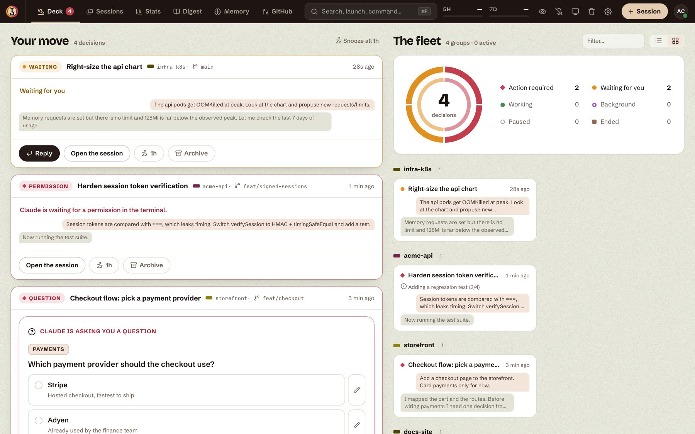
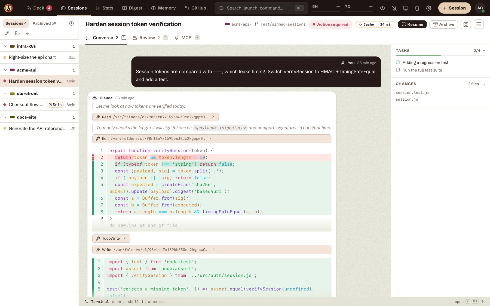
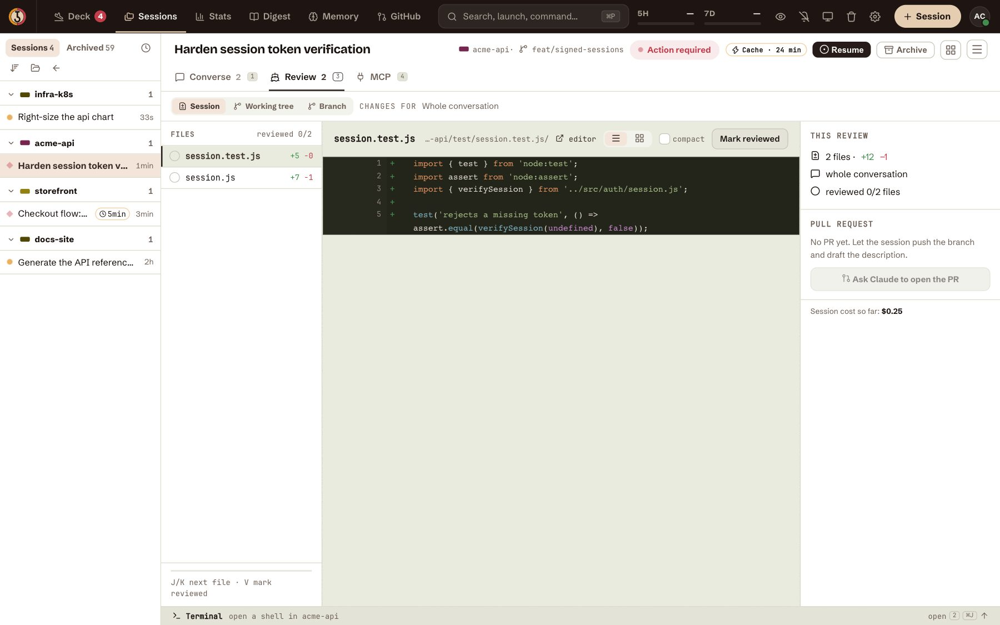
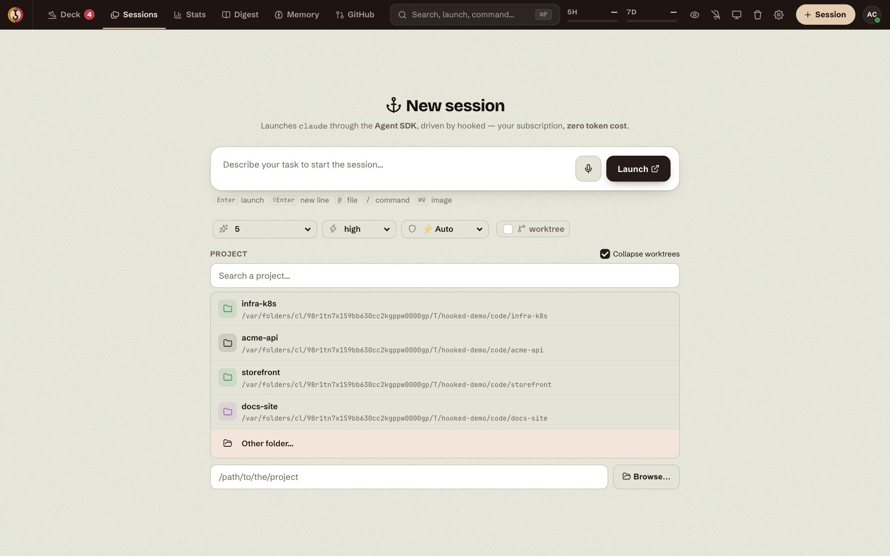
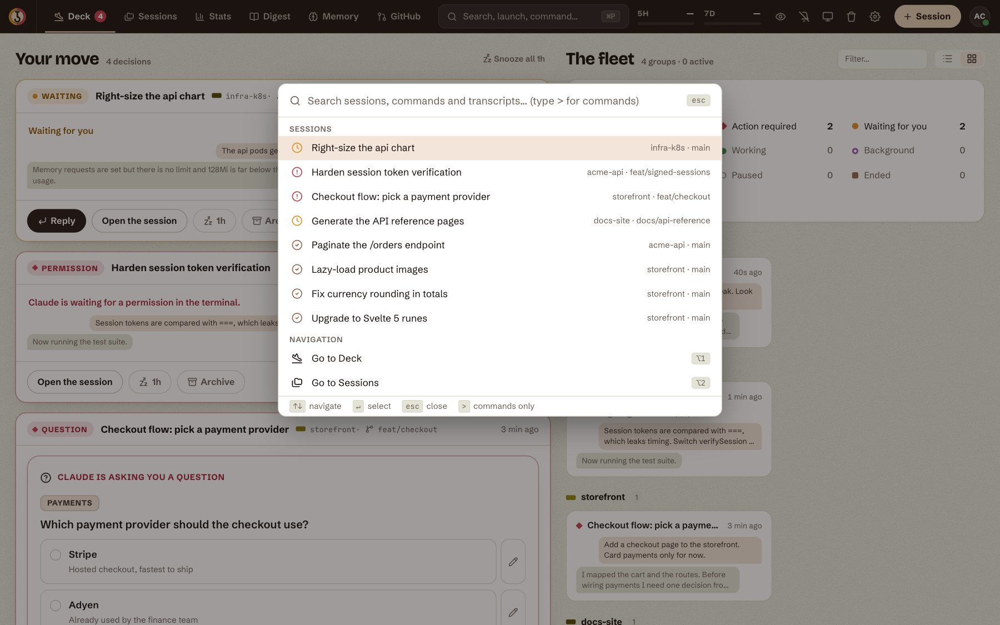
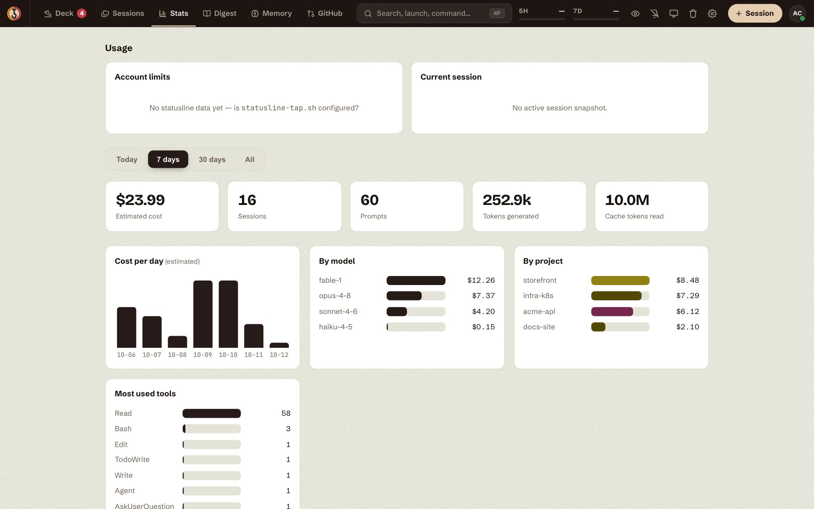
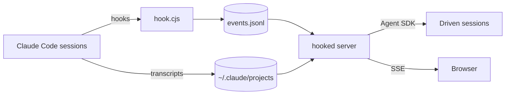

# 🪝 hooked

> [!NOTE]
> hooked is an initiative of its four maintainers:
> [@briangtn](https://github.com/briangtn),
> [@NahisWayard](https://github.com/NahisWayard),
> [@comeChaslerie](https://github.com/comeChaslerie) and
> [@GitBluub](https://github.com/GitBluub).

**A local cockpit for your Claude Code sessions.** See which session needs you, answer it, review
what it changed, and launch the next one, all from the browser.



- 🔒 **100% local.** Nothing leaves your machine.
- 🕹️ **Drives real sessions.** Sessions run through Anthropic's Agent SDK under your own
  subscription: no `claude -p`, no extra token cost.
- ⚡ **Real time.** State is pushed over SSE as soon as a hook fires.
- 👀 **Sees every session**, including the ones you opened in a terminal (read-only).

---

## Features

### 🃏 Deck: what needs you, right now

The home page sorts your sessions into decisions. Permission requests, questions and plans to
approve come first, each with its own card, so you can **answer without opening the session**.
Next to it, the fleet view groups every session by project with its state: action required,
waiting for you, working, background, paused, ended.

- Snooze a session (or all of them) for an hour, archive the ones you're done with.
- Browser notifications when a session starts waiting on you.
- Tags, session groups, a trash with restore, and an **incognito mode** for screen sharing that
  only shows the sessions you marked.

### 💬 Converse: drive the session from the browser



- The full conversation, rebuilt from the transcript: Markdown, Mermaid diagrams, inline diffs
  for every edit, images, subagent calls and background jobs.
- A composer that talks straight to the session: `@` to attach a file, paste an image, `/`
  commands, voice dictation, `!cmd` to run a shell command in the chat. Messages sent while Claude
  works are queued, like in the CLI.
- **Questions, plans and tool permissions** show up as cards: *Allow once* / *Allow always* /
  *Deny* from the browser, no terminal needed.
- Switch the **permission mode** (normal, auto, plan), the **model** and the **effort** live.
  hooked warns you before a model switch throws away a warm prompt cache.
- The dock on the right follows the session: todo list, changed files, subagents, workflows,
  pull requests and screenshots.
- A real terminal (PTY) in the project folder, one shortcut away (`⌘J`).

### 🔍 Review: read the diff like a pull request



- Three scopes: what **this session** changed, the **working tree**, or a whole **branch** against
  its base.
- Comment on any line, then send the whole review to Claude in one go. Claude answers in the
  thread, and threads follow the code when it moves (or get marked outdated).
- Mark files as reviewed (`V`), jump to a symbol's definition with `⌘`-click, see who wrote the
  line under the cursor.
- A **MCP** lens next to it lists the project's MCP servers, their health, and lets you log in to
  the ones that need authentication.

### 🚀 Launch, resume, fork



- Start a session from any project with its model, effort, permission mode and an optional git
  worktree. Favorite projects are pinned at the top.
- **Resume** any past session in one click, **fork** it, or stop it.
- Sessions survive a hooked restart: they are relaunched from the last snapshot, and a session cut
  off mid-turn picks up where it stopped.
- The prompt cache countdown is shown on each session. Optional **auto-compact** compacts an idle
  session just before its cache expires, so coming back later doesn't re-read the whole thread.

### ⌘ Omnibar



`⌘P` searches sessions, commands **and the full text of every transcript**. Type `>` for commands
only. Every shortcut can be rebound in the settings.

### 📊 Stats, Digest, Memory, GitHub



| Page | What it shows |
|---|---|
| **Stats** | Estimated cost, sessions, prompts and tokens over today / 7 days / 30 days / all time, broken down by day, model, project and tool. Live 5 h / 7 d rate-limit gauges in the top bar. |
| **Digest** | An AI recap of the previous day: highlights, then one status line per session. |
| **Memory** | What Claude remembers about you and your projects (its auto-memory notes), searchable and filtered by type. |
| **GitHub** | The pull requests and issues your sessions opened or mentioned, with their review state. Sessions get tagged automatically when their PR is reviewed. |

### 🤖 MCP server

hooked ships an MCP server (`mcp/server.cjs`), so a Claude session can drive the others:
`list_sessions`, `get_session`, `search_sessions`, `start_session`, `reply_to_session`,
`interrupt_session`, `stop_session`, `set_mode`, `set_model`, `get_stats`, `get_digest`,
`reply_review_comment`, plus `show_image` / `show_video` to display media in the conversation.
A session started this way lands in its parent's group.

### 🎨 And also

Split view for several sessions side by side, focus mode, several themes (including a Datadog-like
one), installable as a PWA, and `claude --remote-control` daemons managed per project.

---

## Requirements

- **[mise](https://mise.jdx.dev)**: it installs the right Node version (≥ 24, needed for
  `node:sqlite`) and runs every project task.
- **Claude Code**, installed and logged in.

That's all: sessions are driven through `@anthropic-ai/claude-agent-sdk`, installed with the
project dependencies.

```bash
# macOS
brew install mise
# any OS
curl https://mise.run | sh

# then, once, in your shell (zsh shown, use `bash` for bash)
echo 'eval "$(mise activate zsh)"' >> ~/.zshrc && exec zsh
```

<details>
<summary><strong>🪟 Windows</strong></summary>

The tested path is **WSL2** (`wsl --install -d Ubuntu`). Do everything inside WSL: install Claude
Code and mise in Ubuntu, then follow the steps below. Claude Code must run inside WSL too, since its
hooks write to the Linux `~/.claude`. The dashboard is then reachable from your Windows browser at
http://localhost:4123.

</details>

## Installation

```bash
git clone git@github.com:qjoly/hooked.git
cd hooked

mise trust        # allow the project's mise.toml
mise run setup    # install Node + deps, build, wire hooked into the Claude Code hooks
mise run start    # start the dashboard
```

Open **http://localhost:4123**.

`setup` adds hooked to the hooks in `~/.claude/settings.json` and keeps a backup next to it
(`settings.json.hooked.bak`).

> [!IMPORTANT]
> **Restart your Claude Code sessions** after `setup` to activate the hooks. Sessions already open
> stay visible through their transcripts, but their live state only appears from their next event.

> [!TIP]
> `mise run service-install` installs hooked as a user service (launchd on macOS, `systemd --user`
> on Linux): it starts at login and restarts on failure. `service-status`, `service-logs`,
> `service-restart` and `service-uninstall` go with it.

<details>
<summary><strong>Without mise</strong></summary>

With Node.js ≥ 24 already installed:

```bash
npm install
npm run setup     # wire hooked into the Claude Code hooks (with a backup)
npm run build
PORT=4123 npm start
```

</details>

## Configuration

Most settings live in the dashboard (`⌘,`): default model, effort and mode, shortcuts, theme,
notifications, auto-compact, which models appear in the pickers…

| Environment variable | Effect |
|---|---|
| `PORT` | HTTP port (default `4123`) |
| `HOST` | Listen address (default `127.0.0.1`; `0.0.0.0` exposes hooked on your network) |
| `HOOKED_NO_RESUME=1` | Don't relaunch the driven sessions at startup |
| `HOOKED_NO_CONTINUE=1` | Relaunch them, but don't send "Continue" to the ones cut off mid-turn |

Costs are estimates computed from the token counts in the transcripts. Prices live in
`server/pricing.js`.

## How it works



1. **`hook.cjs`** is wired into every Claude Code hook and appends one line per event to
   `~/.claude/hooked/events.jsonl`. That gives the live state of *every* session, even one
   opened in a terminal.
2. The **server** also reads the transcripts in `~/.claude/projects` for the conversation, files,
   tokens and costs, and pushes updates to the browser over SSE.
3. Sessions launched from hooked run **inside the hooked process** through the Agent SDK. That is
   what makes replying, approving and switching modes possible from the browser.

## Development

```bash
mise run dev       # Vite with HMR, front end and API in one process (:5173)
mise run test      # Vitest suite
mise run deploy    # rebuild and restart the installed service
mise run screenshots  # regenerate docs/screenshots from fictional data (needs Google Chrome)
mise tasks         # every available task
```

See [`CLAUDE.md`](CLAUDE.md) for the architecture notes and the pitfalls worth knowing before
changing the back end.

## Uninstall

Remove the hooked lines from the `hooks` section of `~/.claude/settings.json` (the backup made by
`setup` is `settings.json.hooked.bak`), then `mise run service-uninstall` if you installed the
service.

## Privacy

Nothing leaves your machine. `events.jsonl` only stores metadata (event, session, folder, tool
name), never the content of your messages. The only outbound calls are the ones Claude Code itself
makes, plus `gh` for the GitHub page and Anthropic's usage endpoint for the rate-limit gauges.
