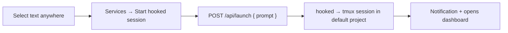

# macOS Quick Action — "Start hooked session"

Start a hooked session from **any** app: select text, right-click → **Services → "Start hooked session"**. The selection is sent as the first prompt; the session launches in the **default project** configured in hooked.



## Prerequisites

- **hooked running** on `http://localhost:4123` (override with `HOOKED_PORT`).
- **A default project set**: hooked → Settings → **Default project**. The Quick Action sends no `cwd`, so `launchSession` falls back to `quickLaunchProject`. Without it the launch returns `directory (cwd) required` (surfaced as a notification).
- **`jq`** and **`curl`** on `PATH`. The bundled script sets `PATH` to `/run/current-system/sw/bin:/opt/homebrew/bin:/usr/local/bin:/usr/bin:/bin:/usr/sbin:/sbin` (covers Nix, Homebrew arm64/x86, and system paths). If your `jq` lives elsewhere, edit the first `export PATH=...` line in the workflow's shell action.

## Install

```bash
./install.sh
```

Copies the bundle to `~/Library/Services/` and flushes the Services cache. Idempotent — re-run to update.

## Use

1. Select text in any app → right-click → **Services → "Start hooked session"**.
2. On first run macOS may ask to allow Apple events / notifications — approve once.
3. **Optional shortcut**: System Settings → Keyboard → Keyboard Shortcuts → **Services** → Text → assign a key to "Start hooked session".

## What it does

The workflow is a single **Run Shell Script** action (input → stdin):

1. Read the selection from stdin; empty selection → notify and stop.
2. Build the JSON body with `jq -Rs '{prompt: .}'` (safe escaping of quotes / newlines).
3. `POST /api/launch` with only `{ prompt }` — no `cwd`.
4. On success: notification + `open http://localhost:$PORT/`. On failure: notification with the server's error message.

## Uninstall

```bash
rm -rf "$HOME/Library/Services/Start hooked session.workflow"
/System/Library/CoreServices/pbs -flush
```

## Notes

- The bundle is plain XML plists (`Info.plist` + `document.wflow`); edit and re-run `install.sh` to iterate. Validate with `plutil -lint`.
- The setting lives server-side in hooked (`settings.json`), so the shell trigger stays dumb — change projects in the UI, not here.
