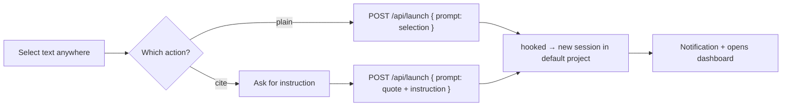

# macOS Quick Actions — "Start hooked session"

Start a hooked session from **any** app: select text, right-click → **Services → "Start hooked session"** (or the **(cite)** variant). The session launches in the **default project** configured in hooked.

Two Quick Actions are bundled:

| Action | Prompt it sends |
|---|---|
| **Start hooked session** | the raw selection, verbatim |
| **Start hooked session (cite)** | the selection quoted as a markdown blockquote (`> …`), a blank line, then an **instruction** you type in a dialog |



## Prerequisites

- **hooked running** on `http://localhost:4123` (override with `HOOKED_PORT`).
- **A default project set**: hooked → Settings → **Default project**. The Quick Actions send no `cwd`, so `launchSession` falls back to `quickLaunchProject`. Without it the launch returns `directory (cwd) required` (surfaced as a notification).
- **`jq`** and **`curl`** on `PATH`. The bundled scripts set `PATH` to `/run/current-system/sw/bin:/opt/homebrew/bin:/usr/local/bin:/usr/bin:/bin:/usr/sbin:/sbin` (covers Nix, Homebrew arm64/x86, and system paths). If your `jq` lives elsewhere, edit the first `export PATH=...` line in the workflow's shell action.

## Install

```bash
./install.sh
```

Installs every `*.workflow` next to the script into `~/Library/Services/` and flushes the Services cache. Idempotent — re-run to update.

## Use

1. Select text in any app → right-click → **Services → "Start hooked session"** (or **"(cite)"**).
2. On first run macOS may ask to allow Apple events / notifications — approve once.
3. **Optional shortcut**: System Settings → Keyboard → Keyboard Shortcuts → **Services** → Text → assign a key to either action.

## What they do

Each workflow is a single **Run Shell Script** action (input → stdin):

**Start hooked session**
1. Read the selection from stdin; empty → notify and stop.
2. Build the JSON body with `jq -Rs '{prompt: .}'` (safe escaping of quotes / newlines).
3. `POST /api/launch` with only `{ prompt }` — no `cwd`.
4. On success: notification + `open http://localhost:$PORT/`. On failure: notification with the server's error.

**Start hooked session (cite)** — same, but first prompts for an instruction:
- If `~/bin/hooked-prompt-panel` is executable, it's used to collect the instruction (a glassy Spotlight-style native panel).
- Otherwise it falls back to an AppleScript `display dialog`. **The panel is optional** — the action works without it.
- The selection is prefixed with `> ` per line and the instruction appended, so the session opens with the cited text as context plus your ask.

### The native panel (`hooked-prompt-panel`)

The panel source is bundled: [`hooked-prompt-panel.swift`](./hooked-prompt-panel.swift) — a small AppKit one-shot input (reads the citation on stdin, prints the typed instruction on stdout; exit 0 = submitted, 1 = cancelled). `install.sh` builds it to `~/bin/hooked-prompt-panel` when `swiftc` is present; otherwise `(cite)` uses the AppleScript dialog. Build manually with:

```bash
swiftc -O hooked-prompt-panel.swift -o ~/bin/hooked-prompt-panel
```

## Uninstall

```bash
rm -rf "$HOME/Library/Services/Start hooked session"*.workflow
rm -f "$HOME/bin/hooked-prompt-panel"   # if the native panel was built
/System/Library/CoreServices/pbs -flush
```

## Notes

- The bundles are plain XML plists (`Info.plist` + `document.wflow`); edit and re-run `install.sh` to iterate. Validate with `plutil -lint`. In `document.wflow`, shell `>` redirections appear XML-escaped as `&gt;` — that's expected.
- The default project lives server-side in hooked (`settings.json`), so the shell triggers stay dumb — change projects in the UI, not here.
