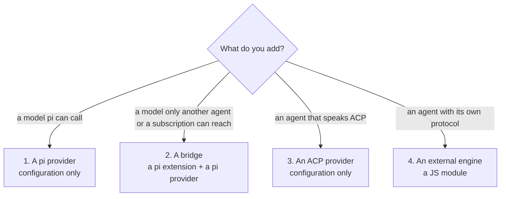
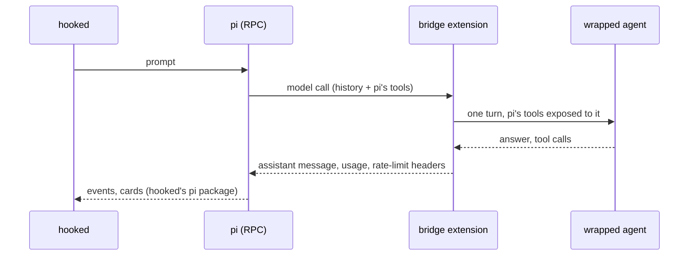

# Adding a provider or a bridge

This guide walks through adding a new provider to hooked: a new model, a new agent, or a bridge
that runs one agent as the model of another. [providers.md](providers.md) is the reference (every
field, capability and engine member). This page says which path to take and what to check.

## Pick the path



| Path | You write | hooked gives you for free |
|---|---|---|
| 1. pi provider | a `providers` entry | session list, conversation, Trace, search, trash, permission / question / plan cards, todos, subagents, workflows, web tools, background commands (hooked's pi package) |
| 2. Bridge | a pi extension (or an existing one) + a `providers` entry | the same as 1, once the points of [the bridge checklist](#bridge-checklist) are covered |
| 3. ACP provider | a `providers` entry | session list (journaled by hooked), conversation, Trace, permission and question cards, modes, models |
| 4. External engine | a module in `~/.claude/hooked/providers/` | what your module implements; a journal store if you want one |

Paths 1 and 2 give the most features, because hooked's pi package runs inside every pi session it
drives ([pi-package.md](pi-package.md)).

## 1. A model through pi

Use this path when `pi --list-models` can list the model, or can once pi has a login or an extension.

1. Give pi access to the model. Use one of these ways:
   - Sign in to a provider pi knows: run `pi auth`, or `/login` in an interactive pi.
   - Install a pi package that registers the provider for every pi session: `pi install npm:<package>`.
   - Load an extension for this provider only, with `args: ["-e", "npm:<package>@<version>"]` in
     step 3. Pin the version: pi does not check a pinned package again on every start.
2. Make sure that pi lists the models, with the same `-e` flags if you use them:

   ```bash
   pi --list-models -e npm:<package>@<version>
   ```

   Note the `provider/model` references in the output (for example `mistral/devstral-medium-latest`).
3. Add the provider: Settings → Providers → **Add a provider**, or edit `settings.json`:

   ```json
   "providers": {
     "mistral": {
       "engine": "pi",
       "label": "Mistral",
       "short": "mi",
       "color": "#fa520f",
       "models": ["mistral/*"],
       "defaultModel": "mistral/devstral-medium-latest",
       "description": "Mistral models through pi."
     }
   }
   ```

4. Make sure that the patterns in `models` select only the models of this provider. hooked attributes
   every pi session to the first provider whose `models` patterns match the session's
   `provider/model`. A session that no pattern matches goes to the catch-all provider `pi`. If `pi`
   adds nothing, hide it: Settings → Providers → `pi` → **Hidden**.
5. Set the options you need:

   | Field | When |
   |---|---|
   | `args` | extensions for this provider only (`-e …`). The model catalogue loads them too |
   | `env` | variables for pi, for example a key. `""` removes a variable |
   | `agentDir` | a separate pi profile: its own logins, models and sessions |
   | `titleModel` | the model that names new sessions (`""` turns naming off) |
   | `modelProvider` | qualifies a bare model id (`devstral` → `mistral/devstral`) |
   | `hookedPackage` | `false` turns hooked's pi package off: no cards, tools auto-approved |
   | `capabilities` | overrides, for example `{ "account": true }` for a model that runs on the Claude account (see the checklist) |

6. Check the result:
   - `GET /api/providers`: the provider is there, with `enabled: true`.
   - `GET /api/provider-options?provider=<id>`: the model picker lists its models.
   - Launch a short session from the dashboard and make sure that it shows the provider's badge.

## 2. A bridge

A bridge is a pi extension that registers a model provider (`pi.registerProvider()`, see pi's
`docs/custom-provider.md`), whose "model" is another agent. pi keeps the conversation, hooked drives
pi, and the wrapped agent answers each turn. pi-claude-bridge is the reference: it runs Claude Code
through the Agent SDK, on the user's own Claude login.



Then follow path 1 with the bridge's extension in `args`. pi-claude-bridge's entry:

```json
"claude-bridge": {
  "engine": "pi",
  "label": "Claude (pi)",
  "short": "cb",
  "models": ["claude-bridge/*"],
  "args": ["-e", "npm:pi-claude-bridge@0.13.0"],
  "capabilities": { "account": true }
}
```

### Bridge checklist

Each point says what hooked does for pi-claude-bridge, and what a new bridge needs.

| Point | Why | For pi-claude-bridge | For a new bridge |
|---|---|---|---|
| Tools | The cards, todos and subagents come from pi's tools | The bridge runs Claude Code with no tool of its own (`tools: []`): Claude calls pi's tools | Expose pi's tools to the wrapped agent, and turn its own tools off |
| Shadow sessions | The wrapped agent may write its own session files where hooked looks for sessions. Each bridged session would then show twice | `server/bridgeShadows.js` hides them: the bridge's state files (`<agentDir>/claude-bridge/sessions/*.json`), the ids seen before (`bridge-shadows.json`), and transcripts whose tool calls all go to `mcp__custom-tools__*` | If the agent writes into `~/.claude/projects` or any store an engine scans, add a matching filter with the bridge's own markers |
| Hooks | The wrapped agent may run the user's hooks, and `hook.cjs` would create a session from them | pi sets `PI_CODING_AGENT=true` on its children, and `hook.cjs` exits on it. hooked strips the variable from the sessions it drives | Nothing more if the agent is a child of pi |
| Context | The wrapped agent may load its own instruction files on top of pi's | The bridge excludes Claude Code's `CLAUDE.md` / `AGENTS.md`. `mise run pi-migrate` copies the global `CLAUDE.md`, skills and MCP servers into pi | Exclude the agent's own context, and bring what matters into pi (`~/.pi/agent/AGENTS.md`, `skills`, `mcp.json`) |
| Quotas | The 5h / 7d gauges read the account's rate limits | The bridge rebuilds `anthropic-ratelimit-unified-{5h,7d}-{utilization,reset}` headers in `after_provider_response`. The pi package relays them to the gauges | Emit the same headers when the agent runs on the Claude account. Other limits have no gauge yet |
| Claude account | The header gauges, the account page, Memory and the 5-hour window appear when something uses the Claude account | `capabilities: { "account": true }` on the provider | Set it only when the bridge uses the Claude subscription |
| Cost | pi reports a cost of 0 for subscription models | hooked prices them with its own table (`server/pricing.js`) | Add the model family to `priceFor()`. An unknown model gets Opus prices |
| Subagents | `Agent` and `Workflow` start a child pi with the parent's `-e` extensions | The child reaches `claude-bridge/*` too, and its pi session lives in a temporary folder, so the bridge records its shadow | Nothing more if the bridge keys its state on pi's session id |
| Resume | A hooked restart relaunches pi with `--session` | The bridge maps pi's session to its Claude Code session and resumes it | Persist the mapping from pi's session id to the agent's session |

## 3. An ACP agent

Agents that speak the [Agent Client Protocol](https://agentclientprotocol.com) need configuration
only:

```json
"gemini": {
  "engine": "acp",
  "label": "Gemini",
  "short": "gm",
  "command": "gemini",
  "args": ["--experimental-acp"]
}
```

hooked journals the sessions, hands its MCP server to the agent, and turns its permission requests
into cards. The model and mode pickers fill in after the first live session. See
[providers.md → ACP agents](providers.md#acp-agents) for the commands of known agents and the parts
of the protocol hooked uses.

## 4. An external engine

Write an engine when the agent has its own protocol. An engine is a module in
`~/.claude/hooked/providers/` (or `HOOKED_PROVIDERS_DIR`):

1. Start from `test/fixtures/providers/echo-engine.mjs`. It is a complete engine with no subprocess.
2. Pick the session store:
   - The journal store (`api.journal`): hooked writes what you send it, and the session list,
     conversation, Trace, todos, search and trash work at once.
   - Your own store: implement `scan`, `conversation` and `trace` on the agent's files.
3. Implement the driver: `start`, `prompt`, `cancel` and `kill` at least. Call `ctx.setLive(id, st)`
   when the session id is known, and `ctx.done(st)` once the launch succeeded. Keep `st.busy` and
   `st.sdkState` current, and call `st.onTurnEnd()` at the end of a turn.
4. For cards, set `st.pendingAsk` (`kind: 'permission'` or `'question'`) with a `resolve` function.
   The dashboard renders it and calls `resolve` with the user's answer.
5. Declare the `capabilities` you implement, so the dashboard shows only the controls that work.
6. Reload: Settings → Providers → **Reload engine modules**, then add a provider that names the
   engine: `"my-agent": { "engine": "<engine id>", "label": "My agent" }`.

The full member list is in [providers.md → Engine interface](providers.md#engine-interface).
`test/providerRegistry.test.mjs` drives the echo engine end to end, and is a good model for a test
of your own.

## Before you rely on it

Run through this list on a test instance first. A dev server on another port, started with its own
data folder, sees the same sessions as the service but keeps its own settings:

```bash
HOOKED_DATA_DIR=~/.claude/hooked-dev HOOKED_PORT=4124 npx vite dev --port 4124 --strictPort
```

`HOOKED_PORT` makes the MCP tools of the sessions it launches talk to it, not to the service. Copy
`~/.claude/hooked` into the data folder first (without `worktrees/`) to start from the same settings.

- The provider is in the launch pickers, with its models, and its sessions show its badge.
- A permission card, a question and a plan approval reach the dashboard and get the answer back.
- A session comes back after `mise run deploy`, without an extra turn.
- Hidden mode works: Settings → Providers → **Hidden** takes the provider out of the pickers, and its
  sessions stay listed and still resume.
- For a bridge: no shadow session shows in the list, the gauges move after a turn, and the costs are
  not zero.

For a real end-to-end test in code, call `launchSession` / `deliverReply` / `killSession` from
`server/agent.js` with `HOOKED_DATA_DIR` set to a temporary folder (see `AGENTS.md` → Tests).

## Shipping it with hooked

To offer the provider to every hooked user:

- Add a template to `TEMPLATES` in `src/lib/components/ProvidersSettings.svelte`. It is then one
  click away in Settings → Providers.
- Document it in [providers.md](providers.md), and in [pi-package.md](pi-package.md) for a bridge.
- A new built-in engine (a new kind of agent, not a new model) goes in `server/engines/` and is
  registered in `server/providers.js`. Most needs fit paths 1 to 4 without one.
