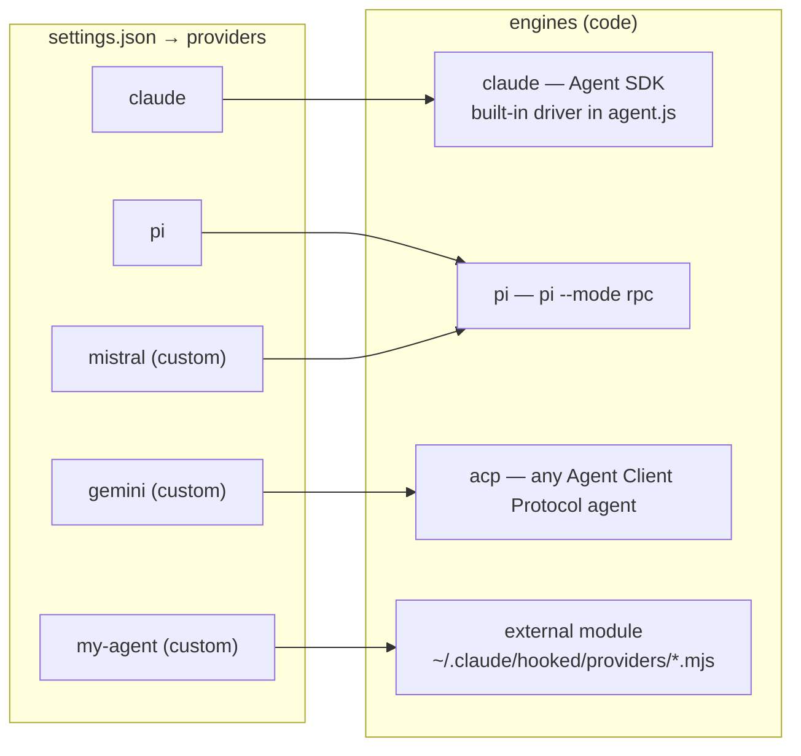

# Providers

hooked drives agents through **providers**. A provider is configuration: what the dashboard shows
and launches. Each provider names an **engine**, which is code: what spawns the agent, talks to it,
and reads its sessions back.

To add one (a model, an agent or a bridge), start with the guide:
[adding-a-provider.md](adding-a-provider.md). This page is the reference.



| Layer | Where | What it decides |
|---|---|---|
| Provider | `settings.json` → `providers` (Settings → Providers) | label, badge, colour, enabled mode, command, args, env, model filters, defaults, capability overrides, engine options |
| Engine | `server/engines/*.js`, or an external module | how to launch / prompt / interrupt / switch model, how to list sessions and rebuild a conversation, what it can do (capabilities) |
| Registry | `server/providers.js` | resolves providers, detects agents, attributes sessions, loads external engines, answers the UI |

The rest of hooked never tests a provider id: it asks the registry for the session's engine
(`engineForSession(s)`), the live driver (`driverFor(st)`) or a capability (`capabilitiesOf(id)`,
`can(id, cap)` on the client).

## Built-in providers and engines

| Provider | Engine | Notes |
|---|---|---|
| `claude` | `claude` | Claude Code through the Agent SDK. The reference implementation: every capability. |
| `pi` | `pi` | The pi coding agent in RPC mode, every model pi is signed in to (`pi --list-models`). hooked's pi package ([pi-package.md](pi-package.md)) brings permission, question and plan cards, modes and hooked's tools. |

| Engine | Sessions are read from | Live driver |
|---|---|---|
| `claude` | `~/.claude/projects/**.jsonl` | `server/agent.js` (Agent SDK) |
| `pi` | `~/.pi/agent/sessions/` (or `<agentDir>/sessions`) | `server/piAgent.js` (RPC over stdio) |
| `acp` | a journal hooked keeps (`~/.claude/hooked/agent-sessions/<provider>/`) | `server/engines/acp.js` (JSON-RPC over stdio) |

## Configuring providers

Settings → Providers edits the same map as `settings.json`:

```json
{
  "defaultProvider": "claude",
  "providers": {
    "claude": "auto",
    "pi": { "enabled": "on", "label": "Pi (all models)" },
    "mistral": {
      "engine": "pi",
      "label": "Mistral",
      "short": "mi",
      "color": "#fa520f",
      "models": ["mistral/*"],
      "defaultModel": "mistral/devstral-medium-latest"
    },
    "gemini": {
      "engine": "acp",
      "label": "Gemini",
      "command": "gemini",
      "args": ["--experimental-acp"]
    }
  }
}
```

A bare string is the enabled mode, the historical shape: `"auto"` detects the agent on this
machine, `"on"` forces it active (for example when launchd froze a PATH that misses the binary),
and `"off"` hides it and refuses launches. Sessions of a provider switched off stay listed: the
setting hides it from the launch pickers, not from the history.

### Fields

| Field | Applies to | Meaning |
|---|---|---|
| `enabled` | all | `auto` / `on` / `off` (shown as **Hidden** in the settings). `off` takes the provider out of the launch pickers; its existing sessions stay listed and still resume (after a restart, Resume, fork) |
| `engine` | custom | engine id: `pi`, `acp`, or an external engine. Built-ins cannot change engine |
| `label`, `short`, `color`, `description` | all | how the provider shows: name, badge (≤ 4 chars), `#hex` colour, picker tooltip |
| `command`, `args` | pi, acp, external | binary and extra arguments (pi: defaults to the resolved `pi`; acp: required) |
| `env` | pi, acp, external | variables for the agent's process. `""` removes one, for example `"ANTHROPIC_API_KEY": ""` |
| `models` | pi, acp | glob patterns (`mistral/*`, `*devstral*`). Filter the model picker, scope pi's `--models`, and attribute sessions (below) |
| `hiddenModels` | pi, acp | ids hidden from this provider's pickers |
| `defaultModel`, `defaultEffort` | pi, acp | used when a launch names none |
| `modelProvider` | pi | qualifies a bare model id (`devstral` → `mistral/devstral`) |
| `hookedPackage` | pi | `false` to launch pi without hooked's package ([pi-package.md](pi-package.md)): no cards, tools auto-approved, `auto` mode only |
| `titleModel` | pi | model that names new sessions (`""` turns naming off; default: a small model of the catalogue) |
| `agentDir` | pi | a separate pi profile (`PI_CODING_AGENT_DIR`): its own auth, models and sessions |
| `modes` | acp | hooked permission mode → agent mode id (`{"plan": "architect"}`). Without it, modes are matched by name |
| `injectHookedMcp` | acp | `false` to not hand hooked's MCP server to the agent (default `true`) |
| `capabilities` | all | overrides of the engine's capabilities (`{"plan": false}`), see below |
| `options` | external | free-form JSON passed to the engine (≤ 16 KB) |

The server sanitises every field. A custom entry without a valid engine is dropped.

### Several providers on one engine

pi is multi-provider by nature, so several hooked providers can share the `pi` engine, each
narrowed by `models`. A pi session is **attributed** to the first provider whose patterns match its
model (`provider/id`, as pi records it). A provider without patterns is the catch-all. In the example
above, sessions on `mistral/*` models show under **Mistral** and every other pi session under **Pi**.
Attribution follows the session's latest model.

`agentDir` gives a provider its own pi profile, so its sessions live in a separate folder and need no
attribution.

## Capabilities

Each engine declares what it supports, and a provider can override any key. The UI shows a
control only when the capability is on.

| Key | Meaning |
|---|---|
| `permissions`, `questions`, `plan` | tool permission cards, agent questions, plan approval |
| `modes`, `autoApprove` | permission mode chips, the per-session auto-approve switch |
| `models`, `effort` | model and effort pickers, live switch |
| `resume`, `fork`, `forkAtMessage` | resume a finished session, fork it, fork from a message |
| `worktree`, `ephemeral`, `images` | launch in a new worktree, self-archiving sessions, pasted images |
| `todos`, `subagents`, `backgroundJobs`, `workflows`, `screenshots`, `subSessions` | dock cards |
| `trace`, `search`, `trash` | Trace lens, full-text search, trash |
| `rateLimits`, `promptCache` | account gauges, the prompt-cache clock |
| `commands`, `skills`, `mcp`, `mcpLogin` | « / » palette, Skills page, MCP lens, OAuth login from it |
| `memory`, `plugins`, `remoteControl`, `account` | Claude-only spaces |

## ACP agents

The `acp` engine drives any agent that speaks the
[Agent Client Protocol](https://agentclientprotocol.com) over stdio. Adding one is configuration
only:

| Agent | `command` / `args` (check your installed version) |
|---|---|
| Gemini CLI | `gemini` / `["--experimental-acp"]` |
| Codex | `npx` / `["-y", "@zed-industries/codex-acp"]` |
| OpenCode | `opencode` / `["acp"]` |
| Goose | `goose` / `["acp"]` |
| Mistral Vibe | `vibe-acp` |

What hooked uses from the protocol:

- `initialize` (the client advertises no `fs` / `terminal` capability: agents use their own tools);
- `session/new` and `session/load` (resume, when the agent advertises `loadSession`);
- `session/prompt` and the `session/cancel` notification;
- `session/set_mode`, `session/set_model` and `session/set_config_option` (model, thought level, mode);
- `session/update` notifications: message and thought chunks, tool calls and their updates (diffs
  become inline diffs), `plan` (becomes the Tasks card), available commands (the « / » palette),
  session title, usage;
- `session/request_permission`, which becomes the same 3-option card as Claude's
  (Allow once / Allow always / Deny map to `allow_once` / `allow_always` / `reject_once`);
- `elicitation/create`, which becomes a question card.

ACP agents keep their history in their own format, so hooked **journals** what it sees on the wire
(`server/engines/journal.js`). That journal gives the provider its session list, conversation view,
Trace lens, todos, search and trash. hooked's own MCP server is handed to every ACP session
(`mcpServers` of `session/new`, with `HOOKED_LAUNCH_KEY`), so `start_session`, `show_panel`,
`archive_this_session`… work from these agents too.

The model, effort and mode pickers of an ACP provider are learnt from the agent's last live session
(cached next to its journals). Before the first launch, only `defaultModel` shows.

## External engines

An engine module is a JS file (or a folder with an `index.js` / `index.mjs`) in
`~/.claude/hooked/providers/`, or in `HOOKED_PROVIDERS_DIR`. hooked loads the folder at boot,
before resuming driven sessions. Settings → Providers → *Reload engine modules* reloads it without
a restart. A module exports its engine as `default`, as `engine`, or as `createEngine(api)`:

```js
// ~/.claude/hooked/providers/echo.mjs — an engine that echoes every prompt.
export function createEngine(api) {
  const { journal } = api; // the journal store, the ACP client, config helpers
  return {
    id: 'echo',
    label: 'Echo',
    capabilities: { trace: true, search: true, trash: true },
    detect: () => true,                     // is the agent installed? (provider in argument)
    available: () => null,                  // null, or why a launch must be refused
    storeKey: (provider) => 'journal:' + provider.id,
    scan: (provider) => journal.scanJournal([provider.id]),
    conversation: (s) => journal.journalConversation(s.file),
    trace: (s) => journal.journalTrace(s.file),
    setArchived: (s, archived) => journal.journalSetArchived(s.file, archived),
    driver: {
      start(st, opts, ctx) {
        st.id = opts.resumeId || 'echo-' + Date.now().toString(36);
        st.journal = journal.openJournal(st.provider, st.id, { engine: 'echo', cwd: st.cwd });
        st.sawMsg = true;
        ctx.setLive(st.id, st);
        ctx.done(st);
        if (opts.prompt) this.prompt(st, opts.prompt);
      },
      prompt(st, text) {
        st.journal.user(text);
        st.journal.text('echo: ' + text);
        st.journal.turnEnd('end_turn');
        return Promise.resolve();
      },
      cancel: () => Promise.resolve(),
      kill(st) { st.ended = true; },
    },
  };
}
```

and a provider that uses it: `"providers": { "parrot": { "engine": "echo", "label": "Parrot" } }`.
The test fixture `test/fixtures/providers/echo-engine.mjs` is this engine, driven end to end in
`test/providerRegistry.test.mjs`.

### Engine interface

Only `id` is required. Everything else is optional, and a missing method degrades the matching
feature (an empty list, a hidden control).

| Member | Purpose |
|---|---|
| `id`, `label` | engine id (built-in ids `claude`, `pi`, `acp` are reserved), display name |
| `capabilities` | defaults, see [Capabilities](#capabilities) |
| `mcpKind`, `skillsKind` | which flavour of the MCP lens / Skills page applies: `'claude'`, `'pi'`, or none |
| `detect(provider)` | is the agent installed (for `enabled: "auto"`), memoised 30 s |
| `available(provider)` | `null`, or the reason a launch is refused |
| `validateModel(m)`, `validateEffort(e)` | `null`, or an error message |
| `storeKey(provider)` | providers sharing a key are scanned once and attributed by model |
| `scan(provider)` | session summaries (shape of `blankSummary` in `server/transcript.js`) |
| `modelRef(s)` | the `provider/id` a session is attributed by |
| `conversation(s)`, `messageText(s, uuid)` | messages in the dashboard shape; the full text of one |
| `trace(s)`, `toolDetail(s, id)` | Trace lens |
| `todos(s)`, `subagents(s)`, `subSessions(s)`, `screenshots(s)`, `backgroundJobs(s)`, `workflows(s)` | dock cards |
| `context(s)` | `{ pct, size, contextWindow }` for the CTX gauge |
| `toolPaths(s)` | files the session's tools touched (allowlist of `/api/user-file` and screenshots) |
| `setArchived(s, archived)` | trash / restore |
| `resumeCommand(s)` | shell command to resume by hand, or null |
| `options(provider)` | `{ models, activeModel, thinkingLevels, modes }` for the pickers |
| `slashCommands(provider, cwd)` | « / » commands when no live session declared any |
| `driver` | the live driver, below. Without one, the provider cannot launch |

`driver` requires `start`, `prompt`, `cancel` and `kill`. It can add `setMode(st, mode)`,
`setConfig(st, { model, effort })`, `fork(id, opts, ctx)`, `compact(st)`,
`answerQuestion(st, ask, { selections, answers })` and `liveCommands(st)`.

`st` is hooked's registry entry for the session. It is shared with the Claude path, so the dashboard
reads the same fields whatever the engine:

| Field | Set by | Meaning |
|---|---|---|
| `provider`, `providerConfig`, `cwd` | hooked | resolved provider config: read your options from it |
| `id` | driver | session id (`ctx.setLive(id, st)` once known) |
| `busy`, `sdkState` (`running` / `idle` / `requires_action`), `activity` | driver | live state |
| `stream` (`{ text, thinking, tool }`), `lastProse` | driver | live preview (`ctx.emit(st)` pushes it) |
| `pendingAsk` (`{ kind: 'permission' \| 'question', id, toolName, questions?, resolve }`) | driver | a card waiting for the user; `resolve({ behavior: 'allow' \| 'deny', allowAlways?, selections?, freeTextAnswer? })` |
| `autoApprove`, `permissionMode`, `model`, `effort` | both | session controls |
| `onTurnEnd` | hooked | call it when a turn ends (ephemeral sessions archive themselves then) |

`ctx` (third argument of `start`) carries `setLive(id, st)`, `persistLaunch(id, model, effort)`,
`done(st)` (the launch succeeded), `failStartup()` (with `st.error` set), `emit(st, now)` and
`hookedMcp()` (hooked's MCP server as `{ command, args, env }`).

`api` (argument of `createEngine`) carries `journal` (the store of `server/engines/journal.js`),
`AcpClient` (to build on ACP), `providerEnv(base, provider)`, `modelMatches(patterns, ref)` and `log`.

## API

| Endpoint | |
|---|---|
| `GET /api/providers` | providers (descriptors, capabilities), engines, external module status |
| `POST /api/providers` `{ action: 'reload' }` | reload external engine modules |
| `GET /api/provider-options?provider=<id>` | launch options of one provider |
| `GET /api/sessions` | adds `providerList`, and `providers` (`{ id: enabled }`) |
| `POST /api/launch` | `provider` is any provider id (default: `defaultProvider`) |
| MCP `list_providers`, `start_session { provider }` | the same from an agent |

`/api/pi-options` stays as an alias of `/api/provider-options?provider=pi` for older clients.
