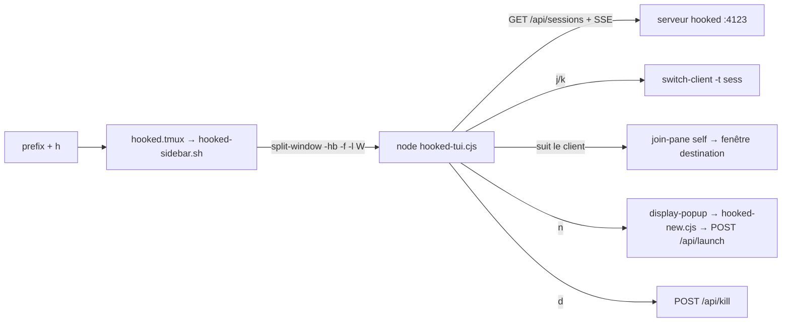

# 🧭 hooked — sidebar tmux

Une **sidebar dans tmux** (inspirée d'[opensessions](https://github.com/Ataraxy-Labs/opensessions)) pour naviguer entre les sessions Claude Code suivies par [hooked](../README.md), directement au clavier, sans quitter tmux.

TUI **Node zéro dépendance** (ANSI brut) — même philosophie que le back de hooked. Aucune brique compilée, aucun paquet npm.

## Ce que ça fait

- **Liste les sessions actives** de l'inbox : pane tmux vivant + état `working` / `background` / `waiting` / `attention` (ou une question / un plan en attente). Deux lignes par session, comme l'inbox : **titre** + **chemin du projet** (`~` abrégé).
- **Naviguer = switcher.** `j` / `k` (ou ↑/↓) déplacent la sélection **et** font `tmux switch-client` vers la session correspondante ; `1`-`9` sautent directement. La sidebar **suit** le client : elle re-`join-pane` **son propre pane** dans la fenêtre de destination — elle ne touche **jamais** aux panes Claude que hooked gère.
- **Filtrer** (`/`), **stopper** une session (`d`, avec confirmation), **créer** une session (`n`, formulaire en popup).
- **Temps réel** : la liste vient de `GET /api/sessions` et se rafraîchit via **SSE** (`GET /api/stream`).

## Raccourcis

| Touche | Action |
|--------|--------|
| `j` / `k`, ↑ / ↓ | déplacer la sélection **et** switcher vers cette session |
| `1`–`9` | sauter à la Nᵉ session (et switcher) |
| `g` / `G` | première / dernière session |
| `/` | filtrer (titre / projet / chemin / branche) ; `↵` applique + saute au 1ᵉʳ résultat, `Échap` efface |
| `d` | **stopper** la session sélectionnée (`POST /api/kill`) — confirmation `y`/`n` |
| `n` | **nouvelle session** : ouvre un popup tmux avec le formulaire (dossier, prompt, modèle, effort, worktree) → `POST /api/launch` |
| `↵` | rester sur la session courante et fermer la sidebar |
| `q` / `Échap` | fermer et revenir à la session de départ |

## Prérequis

- Le **serveur hooked doit tourner** (par défaut `http://127.0.0.1:4123`).
- **`node`** disponible (voir la note PATH plus bas).
- **tmux ≥ 3.3** (bordure de popup `-b rounded`, `join-pane -f`).

## Installation

Ajoute dans `~/.tmux.conf` (les options **avant** le `run-shell`), puis recharge (`tmux source-file ~/.tmux.conf`) :

```tmux
# options (facultatives)
set -g @hooked-sidebar-key   'h'      # touche de toggle, après le prefix (défaut: h)
set -g @hooked-sidebar-width '40'     # largeur de la sidebar, en colonnes
set -g @hooked-port          '4123'   # port du serveur hooked
set -g @hooked-node          ''       # binaire node absolu si absent du PATH de tmux (nvm/mise…)

run-shell '/chemin/vers/hooked/tmux/hooked.tmux'
```

`prefix + h` ouvre / ferme la sidebar à gauche de la fenêtre courante (rappelée depuis une fenêtre qui ne l'a pas → elle y est déplacée).

> [!NOTE]
> **PATH & node.** Le `run-shell` de tmux n'hérite pas forcément du PATH interactif : si `node` est géré par **nvm / mise / asdf**, renseigne `@hooked-node` avec le chemin absolu (`command -v node`). *(Le popup « nouvelle session », lui, réutilise le `node` de la sidebar via `process.execPath` — pas besoin de le reconfigurer.)*

> [!TIP]
> **TPM.** L'entrée `*.tmux` étant dans le sous-dossier `tmux/`, l'auto-chargement par `set -g @plugin 'user/repo'` ne la voit pas (TPM ne source que les `*.tmux` à la racine du plugin). Utilise la ligne `run-shell` ci-dessus — elle ne dépend pas de TPM.

## Comment ça marche



1. `hooked.tmux` (point d'entrée) lie la touche de toggle à `hooked-sidebar.sh`.
2. `hooked-sidebar.sh` crée / ferme / rappelle le pane sidebar (identifié par `pane_title = "hooked-sidebar"`).
3. `hooked-tui.cjs` rend la liste et, à chaque déplacement, `switch-client` puis re-`join-pane` **son propre pane** dans la fenêtre cible (le pane suit le client sans toucher aux panes Claude).
4. `hooked-new.cjs` est le formulaire de nouvelle session, lancé dans un `display-popup`.

## Fichiers

```
tmux/
├─ hooked.tmux          point d'entrée (bindings tmux)
├─ hooked-sidebar.sh    toggle : ouvre / ferme / rappelle le pane sidebar
├─ hooked-tui.cjs       la sidebar (TUI Node, ANSI brut)
└─ hooked-new.cjs       formulaire « nouvelle session » (popup) → POST /api/launch
```
